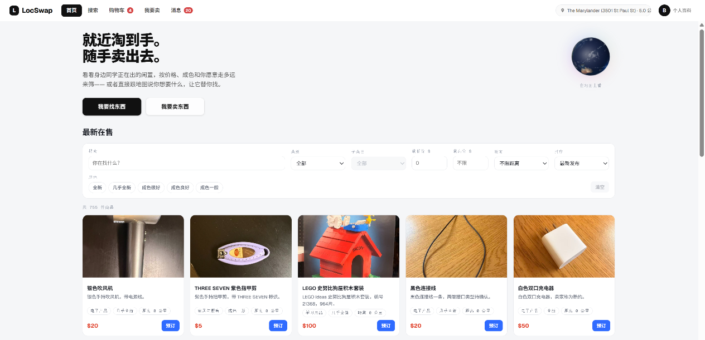
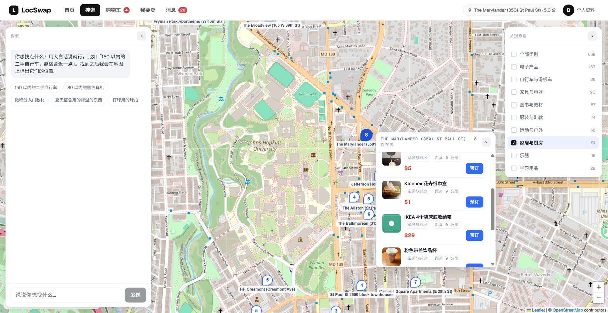
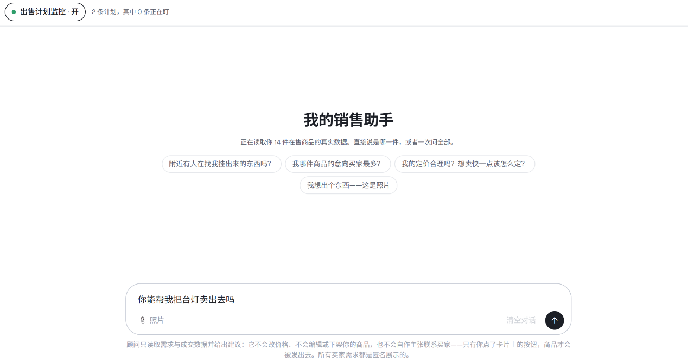
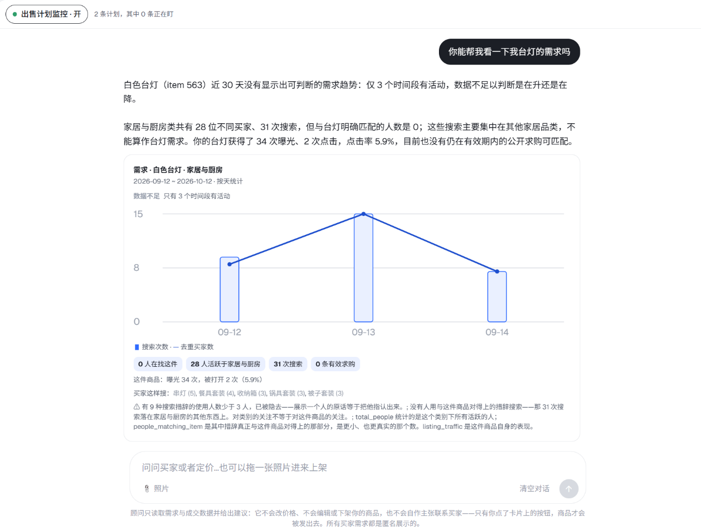
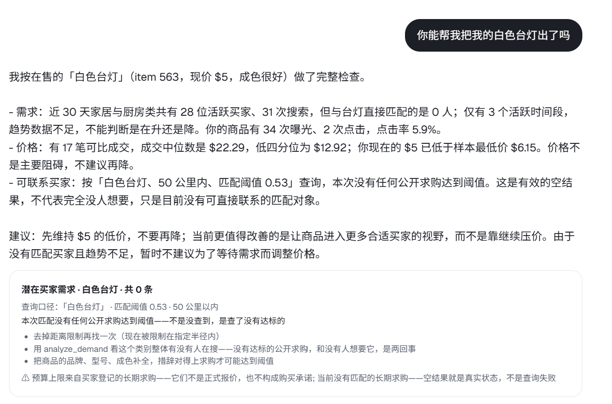
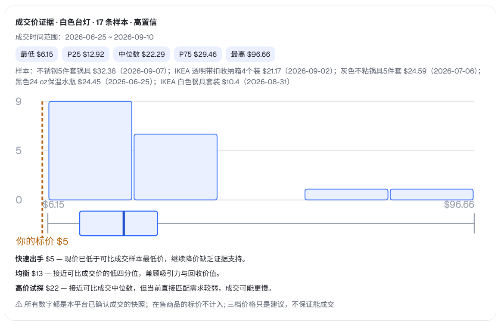
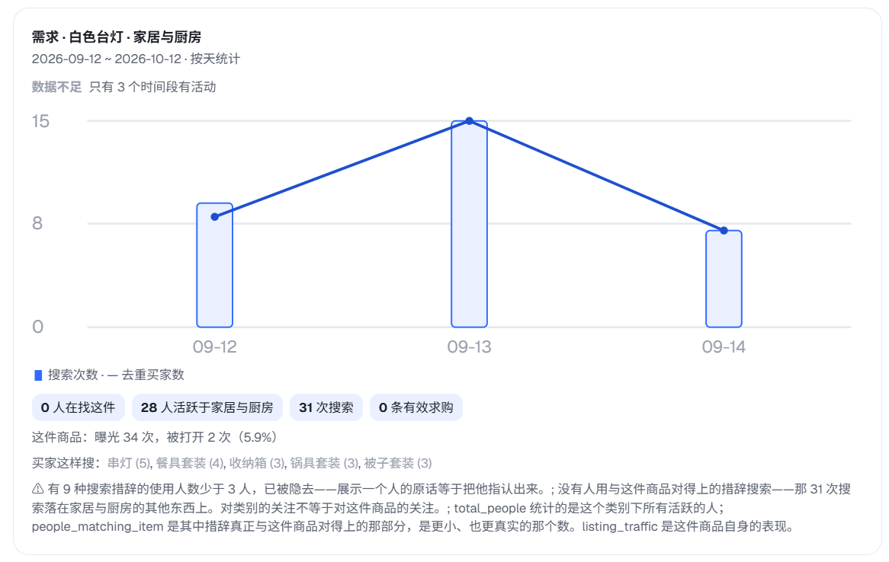
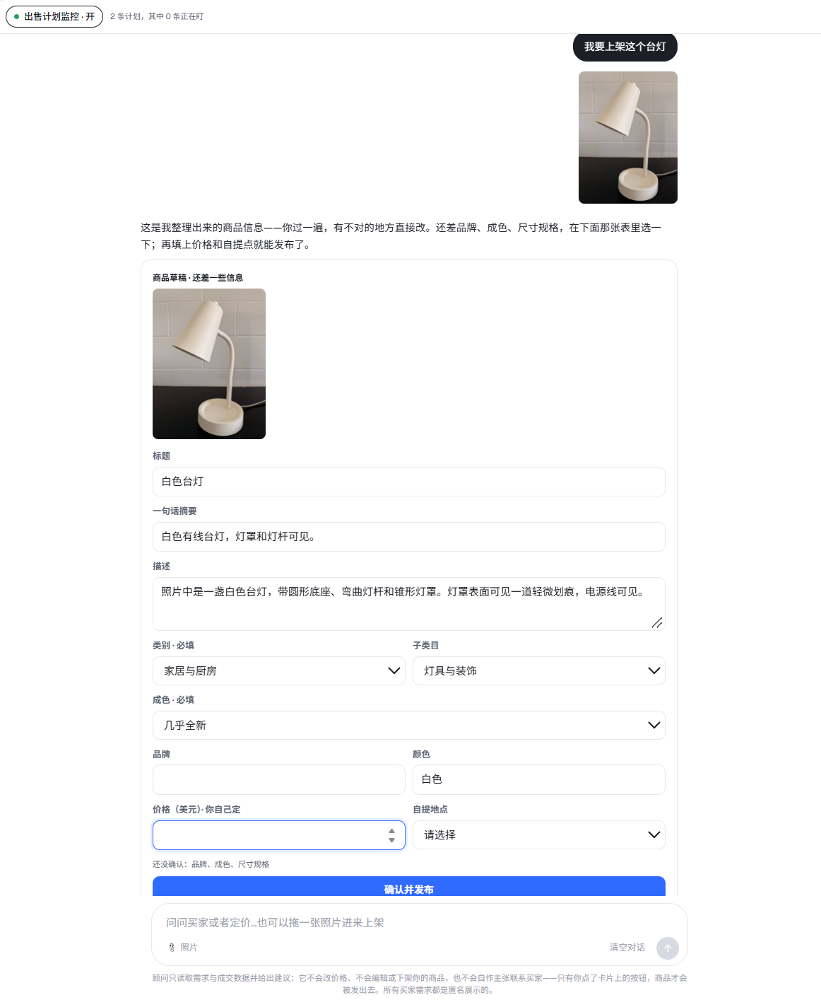
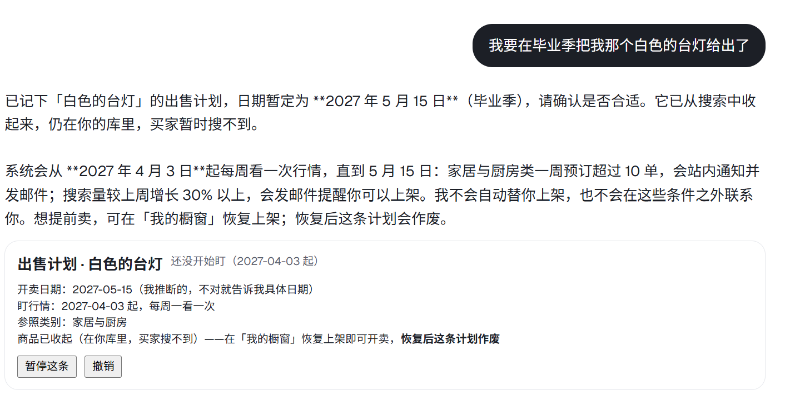
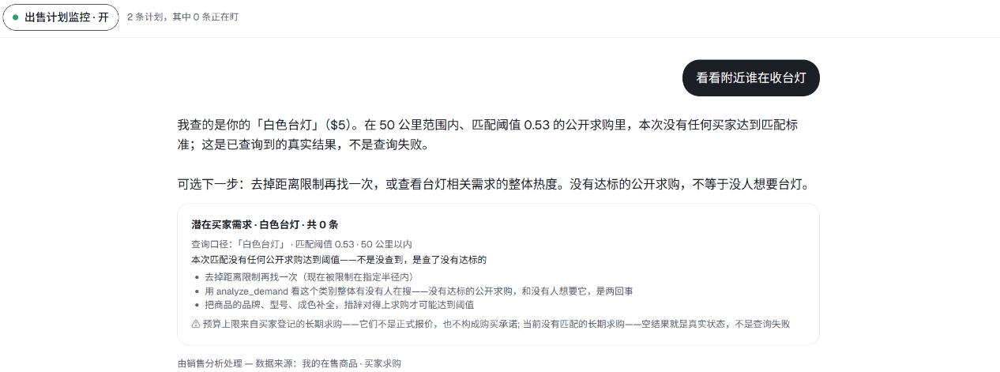

# LocSwap · Campus Second-hand Marketplace

[中文](README.md) · Live demo: <https://locswap.cn>

LocSwap is a second-hand marketplace for a university campus. It is set around the Johns Hopkins University (JHU) Homewood campus, with 18 apartment and townhouse pickup locations built in. The UI is in Chinese and prices are in US dollars.

It targets the friction on both sides of a campus resale:
- **Buyers** don't want to page through listings. They want to say "a bike under $300, close to me".
- **Sellers** don't know what to charge, whether anyone wants the item, or how to describe it.

So the buyer side uses **rule-based parsing plus three-leg conversational retrieval**. The seller side has a **LangGraph sales-advisor agent** that queries data, finds potential buyers, and reviews and drafts listings. Every write action needs the seller's explicit confirmation before it runs.

---

## Features

### Buyers

- **Browse board**:
  - Filter by keyword, category (and its subcategories), price range, condition and distance, with 5 sort orders and paging.
  - **Works without signing in**; distances are then measured from the campus centre.
- **Conversational search**:
  - Describe what you want in plain language. Price, distance, category, brand and condition are extracted, then three-leg recall and fusion run (see [Retrieval pipeline](#retrieval-pipeline)).
  - Asks one clarifying question when the request is too vague.
  - Requests for other people's contact details are refused without calling a model.
- **Map**: a Leaflet map with one pin per pickup location; reserve straight from the pin.
- **Reservations**:
  - The first reservation locks the item as "reserved" and starts a 24-hour confirmation countdown.
  - Several buyers can queue, and the cart shows each buyer's place in line.
  - When the seller confirms a deal, the other buyers in the queue are notified.
  - Items not confirmed in time are cleaned up automatically.
- **Wants**:
  - An unfulfilled search is saved as a want.
  - Wants can also be added by hand, or with "notify me when it's in".
  - With auto-notify on, a new listing whose name covers the want's key words triggers an in-app notification.
- **Inbox**: notifications for deals confirmed or lost, matched wants, sale-plan alerts and more.

### Sellers

- **Manual listing**: upload a photo (compressed server-side to a 1024 px long edge), then pick category and condition and set price and pickup location. The subcategory is optional; left empty, the item goes under the category's "other" bucket. No AI involved.
- **My showcase**: view the reservation queue, confirm a deal, pause or resume a listing, or delete it permanently.
- **Sales advisor chat** (LLM required): supports multiple threads that can be created, renamed and deleted; conversations are stored in SQLite.
  - **Intent routing**: each turn first decides what the seller wants: analysis, publishing, a status change, "sell it later", or a clarifying question.
  - **Working out which listing the seller means**: when the seller names something ("do I have a desk lamp listed?"), the head noun of what they said is first compared with the head noun stored on each listing; only if that cannot decide does a model make the call (call site I), and its answer must also pass a subcategory check. So "desk lamp" finds an "LED eye-care desk light", while "bike reflector" is not mistaken for the bike. If the model call fails, it falls back to matching title tokens.
  - **Analysis** (read-only tools):
    - my items;
    - potential buyers, matched from wants and shown as anonymous cards;
    - sold-price distribution in the category;
    - demand trend and traffic.
  - **Two write actions**: "push my listing to this buyer" and "pause / resume a listing".
    - The agent proposes; nothing runs until the seller replies yes.
    - Permanent deletion cannot be done from chat.
  - **Publishing flow**:
    1. Compliance review against a rule book (16 blocking rules, 12 warnings), including the photo.
    2. An editable draft listing is generated.
    3. Nothing goes live until the seller edits and approves it, and the server re-runs the review on approval.
  - **Sale plans**: when a seller says "I'll sell this next semester", the target date is recorded and the item can be hidden in the meantime.
    - A weekly check reads demand in the category: a week with high reservations sends an in-app notification and an email; a sudden week-on-week surge sends email only.
    - Plans can be paused, resumed or cancelled from chat or from the plan card.
- **Email**: every message is written to an outbox table first. It is only actually sent when SMTP is configured (`EMAIL_ENABLED=true`), which is off by default.

---

## Screenshots and examples

The UI is in Chinese; the captions explain what each screen shows. All items, buyers and sales in the images are demo data, and the demand and sales history comes from the 12 weeks of activity simulated by `scripts/simulate_platform.py`. Captured on 2026-10-12. The images, and a PDF that collects them, are in `screenshots/`.

### Buyer side

#### Home



- The top bar holds the main navigation: Home, Search, Cart, Sell and Messages. The current location sits at the top right, and distances are measured from it.
- The globe on the right is drawn with three.js.
- "Latest listings" can be filtered by keyword, category, subcategory, price range, distance and condition, with 5 sort orders. Every item card has a Reserve button.

#### Map search



- Conversational search is on the left. Describe what you want in plain words, e.g. "a used bike under 150, close to me". The system parses price, distance, category and other conditions out of the sentence before searching; see [Retrieval pipeline](#retrieval-pipeline).
- The Leaflet map in the middle puts a pin on each of the 18 built-in meeting points, and the number on a pin is how many items are listed there. Opening a location lists its items, which can be reserved directly.
- Category filters are on the right, each with its item count.

### Seller side: the sales advisor

#### Entry screen



- The "sale-plan monitoring" pill at the top is a master switch. Next to it is how many sale plans exist and how many are being watched right now. The switch writes the same field as the `set_plan_watch` tool in the conversation, so telling the advisor "turn all reminders off" also turns the pill off.
- The suggested prompts in the middle cover what the advisor can do: find potential buyers, check which items have the most interested buyers, check pricing, and list an item from a photo.

All five examples below are about the same item, a "white desk lamp". Every message first goes through the intent router (call site D) and is then handed to the matching agent. When the seller only says "lamp", the system compares the head noun of that phrase with the head nouns stored on the seller's listed items and resolves it to the white desk lamp. If that comparison is inconclusive, a model decides instead (call site I). The call sites are listed under [LLM call sites](#llm-call-sites).

#### Example 1 · Demand for one item

> Can you check the demand for my lamp?



The sales advisor (call site C) calls the `analyze_demand` tool. The card shows three layers:

- **This item**: 0 people are looking for it. A search only counts if its wording overlaps with the item name.
- **Its category**: 28 active buyers and 31 searches in Home & Kitchen.
- **The listing's own traffic**: 34 impressions and 2 opens.

"How buyers search" lists only phrasings used by at least 3 people. Phrasings used by fewer than 3 people are hidden, so no individual buyer can be singled out.

> **Reading note**: demand data currently comes only from the simulated history (see [Known limitations](#known-limitations)). That history ends on 2026-09-14, so only 3 days fall inside the 30-day window. The card says "insufficient data" and doesn't call a trend.

#### Example 2 · "Help me sell the lamp"

> Can you help me sell my white desk lamp?



This is a full check. In a single turn the advisor calls three read-only tools, gives its conclusion, and then attaches three evidence cards.

- **Potential buyers** (`find_potential_buyers`, above): within 50 km and at a match threshold of 0.53, no public want qualified. The card says this means "searched, nothing qualified" rather than a failed query, and suggests three next steps: widen the distance, look at demand for the whole category, or fill in the item's details.
- **Sold prices** (`analyze_sold_prices`, first image below): the min, P25, median, P75 and max of comparable sales, with the seller's current price marked on the distribution, plus three reference prices: sell fast, balanced, and test high.
- **Demand** (`analyze_demand`, second image below): the same card as in Example 1.





> **Reading note**: sold-price samples are drawn **by category**, which is why the samples shown are cookware, storage boxes and water bottles rather than lamps. "High confidence" only means there are at least 8 samples; it doesn't mean they're comparable to a lamp. The advisor only makes suggestions and never changes the seller's price.

#### Example 3 · List an item from a photo

> I want to list this lamp (with a photo)



This message goes through the publishing flow:

1. A compliance review of the text and the photo against the rule set (call site E).
2. An editable listing draft extracted from the photo and text (call site F): title, summary, description, category, subcategory, condition and color.
3. The bottom of the card lists the fields that still need confirming, here brand, condition and size.

The price field is marked "you decide"; the draft never sets a price for the seller. When the seller clicks "Confirm and publish", the server reviews the submitted content once more and only lists the item if it passes.

#### Example 4 · Sell later

> I want to get rid of my white desk lamp in graduation season



The message is first recognised as "wants to sell, but not now" (call site H) and then handed to the sale-plan agent (call site G):

- "Graduation season" is resolved to 2027-05-15. The card marks this as an inferred date and asks the seller to confirm it.
- The item is hidden from search. It stays in the seller's inventory, but buyers can't find it for now.
- Starting 6 weeks before the sell date (2027-04-03), the category is checked every Monday:
  - more than 10 reservations in a week sends an in-app notice and an email;
  - searches up 30% or more week over week sends an email only.
- The system only sends reminders; it never relists the item on the seller's behalf.
- The plan can be paused or cancelled from the card. If the seller relists the item early from "My listings", the plan is cancelled as well.

#### Example 5 · Find buyers nearby

> Who nearby is looking for a lamp?



This message only calls `find_potential_buyers`, with the same conditions as in Example 2. When nothing qualifies, the card states the query conditions and suggests next steps.

When a want does qualify, the buyer appears as an anonymous card ("Candidate N"). Pushing the item to a buyer is proposed by the advisor first and only happens after the seller confirms. Pushes are also rate-limited; see [Privacy and security](#privacy-and-security).

---

## Tech stack

| Layer | Technology |
|---|---|
| Backend | Python, FastAPI, SQLAlchemy 2, SQLite, Pydantic Settings |
| Retrieval | sentence-transformers (`BAAI/bge-small-zh-v1.5`, 512-dim), ChromaDB (switchable to Milvus / Zilliz Cloud, or in-memory), rank_bm25 + jieba |
| LLM / agents | LangGraph, LangChain, the Anthropic SDK, or any OpenAI-compatible API (e.g. OpenRouter) |
| Frontend | React 18, Vite 5, Leaflet (OpenStreetMap tiles), three.js (home-page globe) |
| Deployment | Docker Compose (app container + nginx container), certbot (HTTPS) |

Authentication is hand-rolled: PBKDF2-SHA256 password hashes and HMAC-signed tokens (not JWT), valid for 7 days by default.

---

## Repository layout

```
.
├── backend/
│   ├── requirements.txt
│   └── app/
│       ├── main.py              # FastAPI entry: create tables, rebuild indexes, start background loops
│       ├── config.py            # every setting (read from .env at the repo root) + campus locations, category/brand dictionaries
│       ├── models.py            # tables
│       ├── routers/             # HTTP API: auth / items / search / reservations / seller / seller_advisor / wants / notifications / meta
│       ├── repositories/        # data access
│       └── services/
│           ├── retrieval.py     # retrieval pipeline (parse → filter → three-leg recall → RRF)
│           ├── query_parser.py  # rule parsing: price, distance, category, brand, condition
│           ├── item_index.py    # item index (vector + BM25 + structured); all writes go through it
│           ├── vector_store.py  # Chroma / Milvus / in-memory vector stores
│           ├── wants.py         # wants, pushes, auto-notify
│           ├── lifecycle.py     # item state machine (selling / reserved / paused / sold)
│           ├── sale_plans.py    # sale plans and the weekly demand check
│           ├── scheduler.py     # background loops: expiry, sale-plan checks
│           ├── llm/             # model access: client (official SDK / OpenAI-compatible), langchain_client (agent models, token metering)
│           ├── nlp/             # deterministic language rules: intent lexicon, date parsing (no model calls)
│           └── agents/          # agent layer
│               ├── graph/       # LangGraph graph: state / nodes / routing (topology) / runtime (compile, checkpoints, run_turn)
│               ├── router.py    # intent routing (call site D); defer_intent.py "sell it later" detection (H)
│               ├── proposals.py # the two confirmed write actions; handoff.py parked tasks; sessions.py threads
│               ├── sales/       # sales advisor: tools and tool-calling loop (C)
│               ├── publishing/  # publishing flow: rule book, compliance, extraction, approval (E, F)
│               └── planning/    # sale-plan agent (G)
├── frontend/
│   ├── vite.config.js           # dev proxy: /api, /static → backend on 8010; /tiles → OSM
│   └── src/
│       ├── App.jsx              # top nav and page switching (no router library)
│       ├── api.js               # every backend call
│       ├── pages/               # home, find, cart, sell, messages, profile, login, onboarding
│       └── components/          # browse board, campus map, globe, sales-advisor chat, ...
├── prompts/                     # system prompts per LLM call site (Markdown, hot-reloaded)
├── scripts/                     # seeding, simulation, calibration, evaluation and verification scripts
├── deploy/                      # Dockerfiles, docker-compose, nginx, deploy scripts (see deploy/README.md, Chinese)
├── screenshots/                 # UI screenshots used in this README, plus a PDF that collects them
└── .env.example                 # configuration template
```

---

## Getting started (local)

### 1. Requirements

- **Python 3.13**, the version used in development and in the Docker image.
- **Node.js 18+**, as required by Vite 5.
- Disk: a few GB for torch plus the embedding model.

### 2. Configuration

Copy the template at the repo root:

```bash
cp .env.example .env            # Windows PowerShell: Copy-Item .env.example .env
```

**It runs without any LLM key.** Browsing, search, reservations, wants and manual listing all work; only the sales-advisor chat is unavailable. To enable it, use one of these in `.env`:

```ini
# Option 1: Anthropic
LLM_PROVIDER=anthropic
ANTHROPIC_API_KEY=your-key

# Option 2: any OpenAI-compatible API (e.g. OpenRouter)
LLM_PROVIDER=openai_compat
LLM_BASE_URL=https://openrouter.ai/api/v1
LLM_API_KEY=your-key
LLM_MODEL_MAIN=provider-model-id
LLM_MODEL_LIGHT=provider-model-id
```

The model must:
- support tool calling;
- accept image input for the main model, because the publishing flow sends the photo for review.

### 3. Install the backend and seed data

```bash
# Optional: install CPU-only torch first to avoid the much larger CUDA build
pip install --index-url https://download.pytorch.org/whl/cpu "torch>=2.2"

pip install -r backend/requirements.txt

# Demo data: 1 buyer + 120 sellers + 560 items (wipes existing data)
python scripts/seed_mock.py

# Optional: simulate 12 weeks of activity on that data (sales, wants and searches dated 2026-06 to 2026-09).
# The advisor's sold-price and demand analysis and the sale-plan check rely on this history.
python scripts/simulate_platform.py --apply
```

Notes on seeding:
- The first run downloads `BAAI/bge-small-zh-v1.5` from Hugging Face. If that is unreachable, set the `HF_ENDPOINT` environment variable to a mirror.
- With `EMBEDDING_BACKEND=auto`, a model that fails to load silently falls back to hashing vectors. Everything still runs, but semantic search gets much worse.
- For a smaller set, use `python scripts/seed.py` instead: 4 accounts and 25 items.

### 4. Run

```bash
# Terminal 1: backend (port 8010)
cd backend
python -m uvicorn app.main:app --reload --port 8010

# Terminal 2: frontend (port 5173)
cd frontend
npm install
npm run dev
```

Open <http://localhost:5173>. In development the API docs are at <http://127.0.0.1:8010/docs>.

**On every start the backend rebuilds** the item, want and rule indexes from SQLite, so with many items it takes a moment. It is ready once `index ready` appears in the log.

### 5. Demo accounts

Every account's password is `demo1234`.

| Data set | Buyer | Sellers |
|---|---|---|
| `seed_mock.py` | `buyer@campus.edu` | `seller001@campus.edu` … `seller120@campus.edu` |
| `seed.py` | `buyer@campus.edu` | `seller1@campus.edu` … `seller3@campus.edu` |

You can also register a new account from the login page.

---

## Key settings

The full list with explanations is in [`.env.example`](.env.example) and [`backend/app/config.py`](backend/app/config.py). The common ones:

| Variable | Default | Purpose |
|---|---|---|
| `LLM_PROVIDER` | `anthropic` | `anthropic` or `openai_compat` |
| `LLM_MODEL_MAIN` / `LLM_MODEL_LIGHT` | `claude-sonnet-4-6` / `claude-haiku-4-5` | main model for the advisor, publishing and plans; light model for query understanding and routing |
| `EMBEDDING_BACKEND` | `auto` | `auto`, `sentence_transformers` or `hashing` |
| `VECTOR_BACKEND` | `chroma` | `chroma`, `milvus` or `memory` |
| `CHROMA_DIR` | `data/chroma` | Chroma persistence directory |
| `MILVUS_URI` / `MILVUS_TOKEN` / `MILVUS_COLLECTION_PREFIX` | empty | needed when using Milvus / Zilliz |
| `VECTOR_MIN_SIMILARITY` / `BM25_MIN_SCORE` | `0.50` / `5.0` | recall floors for the vector and BM25 legs (calibrated on the Chinese corpus) |
| `CONFIRM_WINDOW_HOURS` | `24` | how long a seller has to confirm after a reservation |
| `EMAIL_ENABLED` / `SMTP_*` | off | actually send email |
| `ENVIRONMENT` | `development` | `production` enables a startup check that refuses unsafe config |

With `ENVIRONMENT=production`, startup is refused in cases including:
- `AUTH_SECRET` is the default or shorter than 32 characters;
- `CORS_ORIGINS` is empty or contains `*`;
- `EMBEDDING_BACKEND` is `auto`;
- Milvus is used without a collection prefix.

---

## Retrieval pipeline

The entry point is `backend/app/services/retrieval.py`.

1. **Rule parsing**: regexes and dictionaries extract price (Chinese and English, including Chinese numerals), distance ("nearby" defaults to 1.5 km), category, brand (with Chinese aliases), colour and condition. What remains becomes the semantic text.
2. **LLM query understanding** (optional): the light model is called only when the rules found nothing at all or a clarifying question is needed. Its fields never overwrite rule results. It is skipped when there is no key.
3. **Hard filters**: keep only selling or reserved items, filter by price and by distance (only when the user has set a location), and exclude the user's own items. Category is deliberately **not** a hard filter.
4. **Three recall legs**, up to 20 hits each:
   - **Vector**: bge-small-zh cosine similarity. A hit must reach the absolute floor of 0.50 and be within 0.15 of the best hit.
   - **BM25**: on jieba tokens. A hit must reach the absolute floor of 5.0 and score at least 30% of the best hit.
   - **Structured**: field matching on category, brand and keywords, tiered into head word, modifier and substring matches.
5. **Fusion**: RRF (k = 60), with a penalty for results where the query word is only a modifier, then the top 8. Confidence below 0.25 leads to a clarifying question or a "low confidence" note.
6. **Reply text** comes from templates, with no LLM.

The thresholds are calibrated with `scripts/calibrate_retrieval.py`. Re-run it after changing the corpus or the embedding model.

---

## LLM call sites

| Site | Purpose | Model | Without a key |
|---|---|---|---|
| B | Query understanding and clarification | light | skipped; search still works |
| C | Sales advisor (tool-calling loop) | main | "unavailable" reply |
| D | Intent routing, plus the action proposal after an analysis | router (defaults to light) | the whole advisor chat degrades |
| E | Publishing compliance review (with photo) | main | error, retry prompt |
| F | Draft listing extraction | main | error |
| G | Sale-plan agent | main | degraded reply |
| H | "Sell it later" detection | router | falls back to lexical rules |
| I | Which of the seller's listings they are naming | router | falls back to matching title tokens |

Each call site's system prompt lives in `prompts/`. The tokens each call uses are logged to the `token_usage_log` table; summarise them with `python scripts/token_report.py`.

---

## Privacy and security

- Item cards are built from a field whitelist. A seller's email appears only in a buyer's own cart, that is, after they have reserved the item.
- Email-like strings are stripped before anything is indexed, and searches asking for someone's contact details are refused.
- The advisor sees potential buyers only as anonymous cards ("candidate N"). Pushes are rate-limited per buyer per day and per seller per day, and duplicates for the same want are blocked.
- Only `data/uploads/` is served as a static directory, and photo paths sent back by clients are strictly validated.
- Anonymous searches do not receive retrieval debug information.

---

## Deployment

`deploy/` contains a Docker Compose setup:
- an app container running FastAPI, with the embedding model baked into the image at build time;
- an nginx container that serves static assets and handles cost-tiered rate limiting, map-tile caching, and HTTPS with automatic certificate renewal;
- `deploy/push.sh`, which ships it to a server in one command.

Steps, server choice and pitfalls are in [deploy/README.md](deploy/README.md) (Chinese).

---

## Scripts

| Script | Purpose |
|---|---|
| `scripts/seed_mock.py` | main data set, then rebuild indexes |
| `scripts/seed.py` | small data set (25 items) |
| `scripts/simulate_platform.py` | 12 weeks of simulated history (dry run unless `--apply`) |
| `scripts/calibrate_retrieval.py`, `scripts/eval_retrieval.py` | retrieval threshold calibration and evaluation |
| `scripts/check_production_config.py` | pre-deploy production config check |
| `scripts/backfill_subcategory.py` | add subcategory and head noun to existing items (by default only asks the model and writes a report; `--apply` writes a reviewed report to the database, then restart the backend to rebuild the index) |
| `scripts/smoke_llm.py` | LLM connectivity check with a real call |
| `scripts/token_report.py` | token usage summary |
| `scripts/verify_*.py` | per-feature verification scripts; some need the backend running or an LLM key |
| `scripts/gen_item_images.py`, `scripts/gen_item_photos.py` | generate item photos with an image model (needs an OpenRouter key; billed per image) |

There is no unit-test framework such as pytest; features are verified with the `verify_*.py` scripts above.

---

## Known limitations

- **Demand data is simulated only.** Demand analysis and the sale-plan check read the `demand_event` table, which today is written only by `simulate_platform.py`; real searches and reservations do not write to it.
- **Without an LLM key the whole sales-advisor chat is unavailable**, including recording a sale plan.
- **Single worker only.** The "candidate card → want" map used for pushes lives in process memory for 30 minutes and is lost on restart.
- **Every start re-embeds** every item.
- **Subcategories are used in two places only**: home-page browse filters and the seller looking up their own listings. Conversational search, want matching and demand analysis do not look at them yet, and neither subcategory nor head noun goes into the retrieval vectors. Items listed before this feature need `backfill_subcategory.py` before they have a subcategory; until then a subcategory filter will not find them.
- **The frontend has no URL routing**, so a refresh returns to the home page. Also, the backend allows anonymous search, but the frontend's search page requires signing in.
- **Authentication is demo-grade**: no password recovery, no captcha, no refresh tokens.
- **In the demo data** some colour fields are in English, and the simulated history is fixed to June–September 2026.
